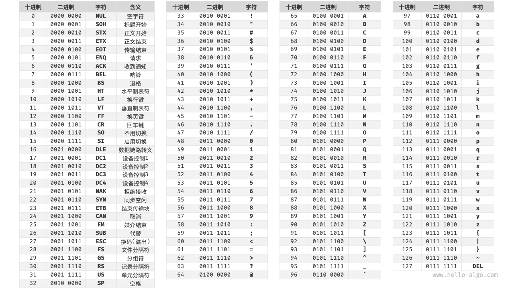
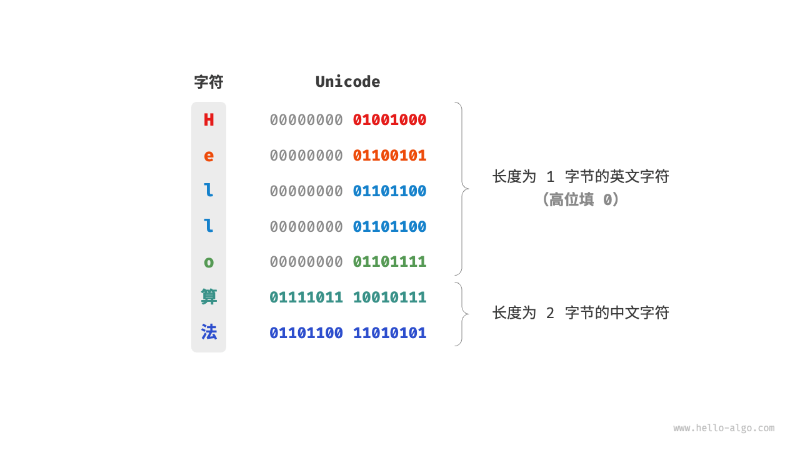
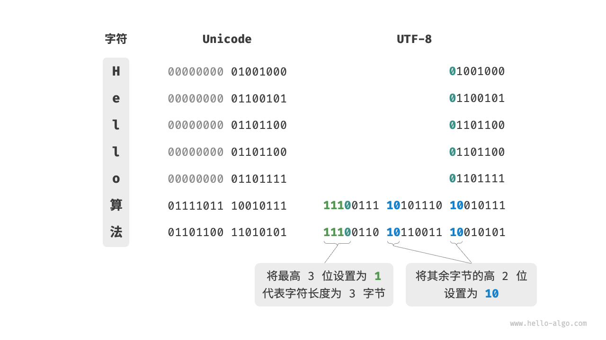

# 字符编码 *

## 一个汉字占几个字节？先问编码

计算机保存文字时，先要知道每个字符对应哪个数字，再决定用哪些字节记录这个数字。Unicode 给字符分配编号，UTF‑8 是把这些编号写成字节的一套规则。一个字节有 8 位。用 UTF‑8 编码 `A中`，`A` 用 1 字节、`中` 用 3 字节，保存时要写 4 字节。打字时，我们却只看到两个字符。

??? question "在第 2 个字节处截断会发生什么？"

    这会把 `中` 的多字节序列截断。要按显示字符截取，应先按文本边界处理，再编码成字节。

这里有两个问题。第一是有什么字符可以表示，这由**字符集**决定。第二是怎样把这些字符写成字节，这是**字符编码**的事。Unicode 分配给字符的编号叫**码点**。一个看起来完整的字符也可能由多个码点组成，例如 `e` 加上一个组合重音会显示成 `é`。界面让光标移动一格时，通常需要把这两个码点合起来处理。 [Unicode 的组合字符说明](https://unicode.org/faq/char_combmark.html)

## ASCII 字符集

一种早期的字符编码是 <u>ASCII</u>，用 7 位就能区别 128 个编号。存成 1 字节时，最左边的 1 位设为 0。它包含英文字母、数字 `0` 到 `9`、标点，也包含换行或移动到下一个制表位置等用来控制排版的字符。

ASCII 的 128 个编号很快用完，许多语言的字母或汉字都放不进去。一个办法是把第 8 位也用上，将编号范围扩大到 256 个。过去不同地区推出过多种这样的扩展编码，通常保留低 128 个编号的 ASCII 含义，再把较高的编号分给不同字符。因此，收到了相同字节，也要先说清该按哪套规则解释。

## GBK 字符集

一个字节总共只有 256 种取值，常用的汉字却有数千个。<u>GB2312</u> 为中文文本约定了可用的汉字和编码规则，常用汉字用两个字节表示。

然而，GB2312 无法处理部分罕见字和繁体字。<u>GBK</u> 字符集是在 GB2312 的基础上扩展得到的，它共收录了 21886 个汉字。在 GBK 的编码方案中，ASCII 字符使用一个字节表示，汉字使用两个字节表示。

## Unicode 字符集

随着计算机技术的蓬勃发展，字符集与编码标准百花齐放，而这带来了许多问题。一方面，这些字符集一般只定义了特定语言的字符，无法在多语言环境下正常工作。另一方面，同一种语言存在多种字符集标准，如果两台计算机使用的是不同的编码标准，则在信息传递时就会出现乱码。

那个时代的研究人员就在想：**如果推出一个足够完整的字符集，将世界范围内的所有语言和符号都收录其中，不就可以解决跨语言环境和乱码问题了吗**？在这种想法的驱动下，一个大而全的字符集 Unicode 应运而生。

<u>Unicode</u> 的中文名称为“统一码”，理论上能容纳 100 多万个字符。它致力于将全球范围内的字符纳入统一的字符集之中，提供一种通用的字符集来处理和显示各种语言文字，减少因为编码标准不同而产生的乱码问题。

拿到统一的编号以后，还要选一种编码，把编号连续写进文件。假如两个字节既可能是一项的全部，也可能分属两项，读取方该在哪里分段？下面先试一种齐整的办法，再看 UTF-8 怎样直接在字节里写出边界。 [Unicode 对编码形式的说明](https://www.unicode.org/faq/utf_bom.html)

可以先试一个小方案：只处理图中 `Hello算法` 里的字符，给每个编号留 2 字节，小的编号在前面补 0。读取方每次取 2 字节，就能知道从哪里开始读下一项。这样的方案需要为较小编号也留足空间，对大到 2 字节装不下的编号还需要另想办法。

然而 ASCII 码已经向我们证明，编码英文只需 1 字节。若采用上述方案，英文文本占用空间的大小将会是 ASCII 编码下的两倍，非常浪费内存空间。因此，我们需要一种更加高效的 Unicode 编码方法。

## UTF-8 编码

**UTF-8 是一种可变长度的编码**。它根据编号范围分配 1 到 4 字节。例如 `A` 用 1 字节，`é` 用 2 字节，`中` 用 3 字节，`😀` 用 4 字节。第一个字节的开头会告诉读取方还要再读几个字节。

UTF-8 的编码规则并不复杂，分为以下两种情况。

- 对于长度为 1 字节的字符，将最高位设置为 $0$ ，其余 7 位设置为 Unicode 码点。值得注意的是，ASCII 字符在 Unicode 字符集中占据了前 128 个码点。也就是说，**UTF-8 编码可以向下兼容 ASCII 码**。这意味着我们可以使用 UTF-8 来解析年代久远的 ASCII 码文本。
- 对于长度为 $n$ 字节的字符（其中 $n > 1$），将首个字节的高 $n$ 位都设置为 $1$ ，第 $n + 1$ 位设置为 $0$ ；从第二个字节开始，将每个字节的高 2 位都设置为 $10$ ；其余所有位用于填充字符的 Unicode 码点。

下图展示了“Hello算法”对应的 UTF-8 编码。观察发现，由于最高 $n$ 位都设置为 $1$ ，因此系统可以通过读取最高位 $1$ 的个数来解析出字符的长度为 $n$ 。

只在后续字节上使用 `10` 开头，是为了标明「这一字节要和前面的字节放在一起读」。从文字的中间开始读取时，如果碰见 `10`，就知道当前位置不是一个码点的开头。再往前找，可以找到该从哪个字节开始。字节序列是否有效还要核对其他规则。

除了 UTF-8 之外，常见的编码方式还包括以下两种。

- **UTF-16 编码**：使用 2 或 4 字节来表示一个字符。所有的 ASCII 字符和常用的非英文字符，都用 2 字节表示；少数字符需要用到 4 字节表示。对于 2 字节的字符，UTF-16 编码与 Unicode 码点相等。
- **UTF-32 编码**：每个字符都使用 4 字节。这意味着 UTF-32 比 UTF-8 和 UTF-16 更占用空间，特别是对于 ASCII 字符占比较高的文本。

从存储空间占用的角度看，使用 UTF-8 表示英文字符非常高效，因为它仅需 1 字节；使用 UTF-16 编码某些非英文字符（例如中文）会更加高效，因为它仅需 2 字节，而 UTF-8 可能需要 3 字节。

从兼容性的角度看，UTF-8 的通用性最佳，许多工具和库优先支持 UTF-8 。

## 编程语言的字符编码

用 `A😀` 试一试字符串的「长度」。它包含 2 个码点。写成 UTF-8 时，`A` 占 1 字节、`😀` 占 4 字节，共 5 字节。换成 UTF-16，最小的存取单位是 16 位，一个这样的单位叫**码元**。`A` 用 1 个码元，`😀` 用 2 个，所以总共是 3 个码元。为一个码点配成一组的两个 UTF-16 码元，也叫**代理对**。 [Unicode 的 UTF-16 说明](https://www.unicode.org/faq/utf_bom.html)

同样调用字符串的长度方法，不同语言返回的数字也可能不同。

- Java 的 `"A😀".length()` 数的是 UTF-16 码元，得到 3。若取第 2 个位置，只会得到 `😀` 的一半，要按码点访问才会拿到整项。 [Unicode 的编程说明](https://unicode.org/faq/programming.html)
- Python 的 `len("A😀")` 数的是码点，得到 2。调用 `len("A😀".encode("utf-8"))` 数的是编码后的字节，得到 5。常用的 CPython 实现会按一份字符串的最大编号，选择每个码点占 1、2 或 4 字节。 [PEP 393](https://peps.python.org/pep-0393/)
- Go 的 `len("A😀")` 数的是字节，得到 5。字符串可以装任意字节。当内容是有效的 UTF-8 时，可以用 `range` 遍历码点，Go 把这种用法里的码点值称为 `rune`。 [Go 官方字符串说明](https://go.dev/blog/strings)

决定怎样截取字符串前，先问要数的是写进文件的字节、程序接口使用的码元或码点，还是界面上看到的完整字符。按字节下标可以直接找到第 5 个字节。想知道它属于第几个码点，在没有另建索引时，就要从前面识别每个码点的边界。
