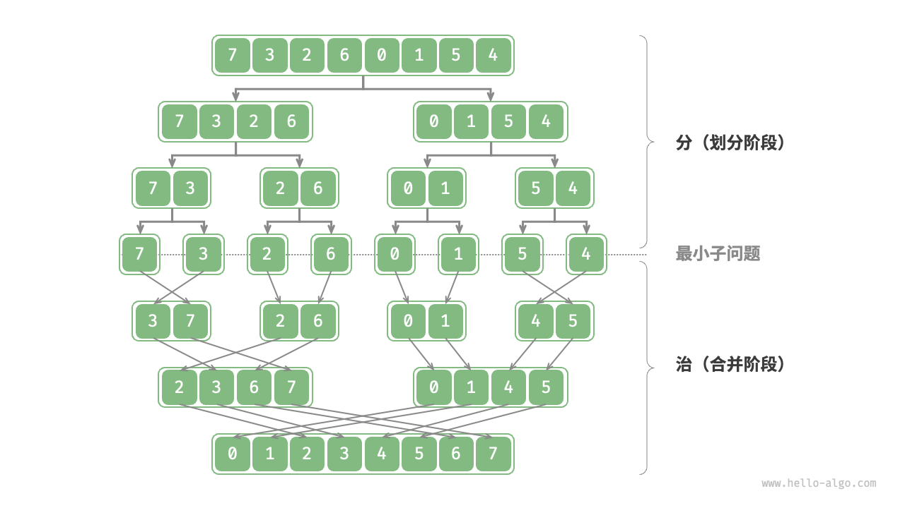
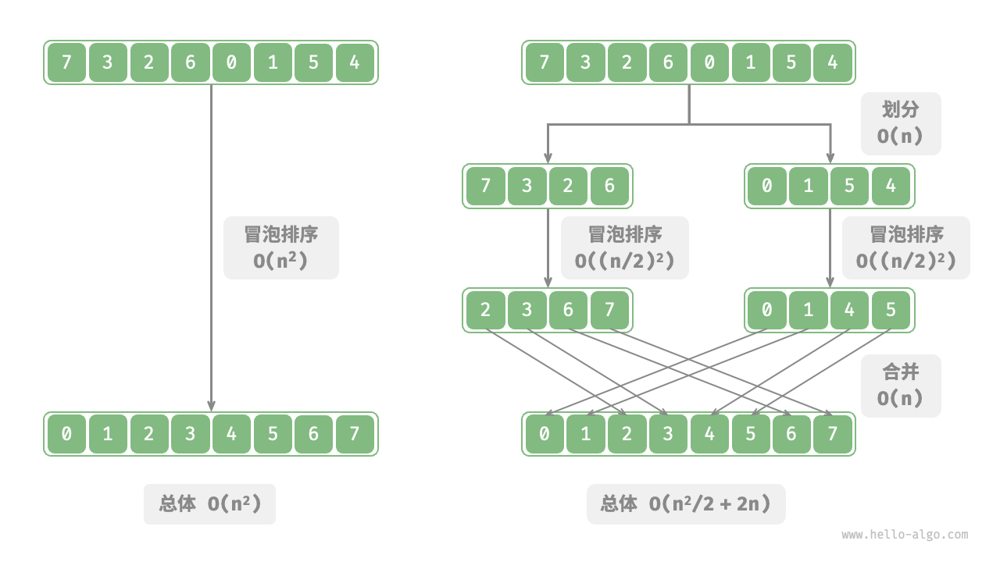
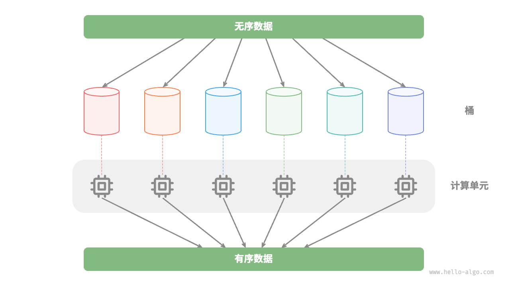

# 分治算法

## 切开问题后，怎样把两个答案接起来？

要找 `[4, 1, 7, 2]` 的最大值，可分成两半，各得 4 和 7，再比较两个答案得到 7。这样做清楚展示了拆分、停止和合并。拆开后要解决的小题叫**子问题**。如果不同分支会遇到同一道小题，反复拆分也可能让它算上好几遍。

??? question "所有问题将数组切成两半都能合并吗？"

    需要一个能从子问题答案推出原答案的办法。例如跨越分界线的结果可能还依赖边界信息，应先想清楚合并需要保留什么。

<u>分治（divide and conquer）</u>，全称分而治之，是一种非常重要且常见的算法策略。分治通常基于递归实现，包括“分”和“治”两个步骤。

1. **分（划分阶段）**：递归地将原问题分解为两个或多个子问题，直至到达最小子问题时终止。
2. **治（合并阶段）**：从已知解的最小子问题开始，从底至顶地将子问题的解进行合并，从而构建出原问题的解。

如下图所示，“归并排序”是分治策略的典型应用之一。

1. **分**：递归地将原数组（原问题）划分为两个子数组（子问题），直到子数组只剩一个元素（最小子问题）。
2. **治**：从底至顶地将有序的子数组（子问题的解）进行合并，从而得到有序的原数组（原问题的解）。

## 如何判断分治问题

一个问题是否适合使用分治解决，通常可以参考以下几个判断依据。

1. **问题可以分解**：原问题可以分解成规模更小、类似的子问题，以及能够以相同方式递归地进行划分。
2. **子问题是独立的**：子问题之间没有重叠，互不依赖，可以独立解决。
3. **子问题的解可以合并**：原问题的解通过合并子问题的解得来。

显然，归并排序满足以上三个判断依据。

1. **问题可以分解**：递归地将数组（原问题）划分为两个子数组（子问题）。
2. **子问题是独立的**：每个子数组都可以独立地进行排序（子问题可以独立进行求解）。
3. **子问题的解可以合并**：两个有序子数组（子问题的解）可以合并为一个有序数组（原问题的解）。

## 通过分治提升效率

**分治不仅可以有效地解决算法问题，往往还可以提升算法效率**。例如[归并排序](../chapter_sorting/merge_sort.md)把两个已排序的半段合起来，每次只比较两个半段还没取走的第一项，合并费时与总长度成比例。速度能提升多少，要看拆分后的小题和合并分别花多少钱。

那么，我们不禁发问：**为什么分治可以提升算法效率，其底层逻辑是什么**？换句话说，将大问题分解为多个子问题、解决子问题、将子问题的解合并为原问题的解，这几步的效率为什么比直接解决原问题的效率更高？这个问题可以从操作数量和并行计算两方面来讨论。

### 操作数量优化

以“冒泡排序”为例，其处理一个长度为 $n$ 的数组需要 $O(n^2)$ 时间。假设我们按照下图所示的方式，将数组从中点处分为两个子数组，则划分需要 $O(n)$ 时间，排序每个子数组需要 $O((n / 2)^2)$ 时间，合并两个子数组需要 $O(n)$ 时间，总体时间复杂度为：

$$
O(n + (\frac{n}{2})^2 \times 2 + n) = O(\frac{n^2}{2} + 2n)
$$

接下来，我们计算以下不等式，其左边和右边分别为划分前和划分后的操作总数：

$$
\begin{aligned}
n^2 & > \frac{n^2}{2} + 2n \newline
n^2 - \frac{n^2}{2} - 2n & > 0 \newline
n(n - 4) & > 0
\end{aligned}
$$

在这份简化的计算里，假设公式中各项的系数都是 1，于是 $n>4$ 就能看到少做操作的效果。真实的拐点由比较、搬运和分配空间的成本决定。请注意，划分后的时间复杂度仍然是平方阶 $O(n^2)$ ，只是复杂度中的常数项变小了。

进一步想，**如果我们把子数组不断地再从中点处划分为两个子数组**，直至子数组只剩一个元素时停止划分呢？这种思路实际上就是“归并排序”，时间复杂度为 $O(n \log n)$ 。

再思考，**如果我们多设置几个划分点**，将每个数按它所在的数值区间送到不同列表（桶）呢？这就是[桶排序](../chapter_sorting/bucket_sort.md)的思路，可以分别排各个桶，再按区间顺序取出。效率取决于元素是否被均匀分到各桶，以及桶内选了什么排序方法。

### 并行计算优化

我们知道，分治生成的子问题是相互独立的，可以试着让不同计算单元同时做这些互不依赖的小题，这叫**并行**。若拆出来的小题很小，分派工作或等待结果的时间可能超过省下的计算时间。

并行优化在多核或多处理器的环境中尤其有效，因为系统可以同时处理多个子问题，更加充分地利用计算资源，从而显著减少总体的运行时间。

比如在下图所示的“桶排序”中，我们将海量的数据平均分配到各个桶中，则可将所有桶的排序任务分散到各个计算单元，完成后再合并结果。

## 分治常见应用

一方面，分治可以用来解决许多经典算法问题。

- **寻找最近点对**：该算法首先将点集分成两部分，然后分别找出两部分中的最近点对，最后找出跨越两部分的最近点对。
- **大整数乘法**：例如 Karatsuba 算法，它将大整数乘法分解为几个较小的整数的乘法和加法。
- **矩阵乘法**：例如 Strassen 算法，它将大矩阵乘法分解为多个小矩阵的乘法和加法。
- **汉诺塔问题**：汉诺塔问题可以通过递归解决，这是典型的分治策略应用。
- **求解逆序对**：在一个序列中，如果前面的数字大于后面的数字，那么这两个数字构成一个逆序对。求解逆序对问题可以利用分治的思想，借助归并排序进行求解。

另一方面，分治在算法和数据结构的设计中应用得非常广泛。

- **二分查找**：二分查找是将有序数组从中点索引处分为两部分，然后根据目标值与中间元素值比较结果，决定排除哪一半区间，并在剩余区间执行相同的二分操作。
- **归并排序**：本节开头已介绍，不再赘述。
- **快速排序**：快速排序是选取一个基准值，然后把数组分为两个子数组，一个子数组的元素比基准值小，另一子数组的元素比基准值大，再对这两部分进行相同的划分操作，直至子数组只剩下一个元素。
- **桶排序**：桶排序的基本思想是将数据分散到多个桶，然后对每个桶内的元素进行排序，最后将各个桶的元素依次取出，从而得到一个有序数组。
- **树**：在[二叉搜索树](../chapter_tree/binary_search_tree.md)中，比较完一个节点的值，只需继续查它的一侧。索引用的 [B 树](../chapter_tree/block_indexes.md)还可以一次排除多个方向。
- **堆**：[从下往上建堆](../chapter_heap/build_heap.md)时，可以先整理两棵子树，再决定怎样调整它们的父节点。
- **哈希表**：如果太多键落进[同一个桶](../chapter_hashing/hash_collision.md)，可以用限制高度的搜索树来存放该桶记录。用树查找时，每次比较可以排除一侧。

可以看出，**分治是一种“润物细无声”的算法思想**，隐含在各种算法与数据结构之中。
