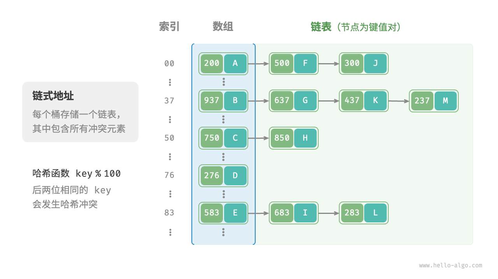
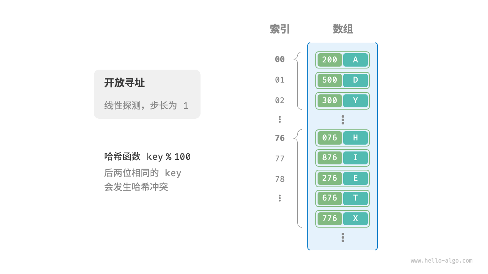
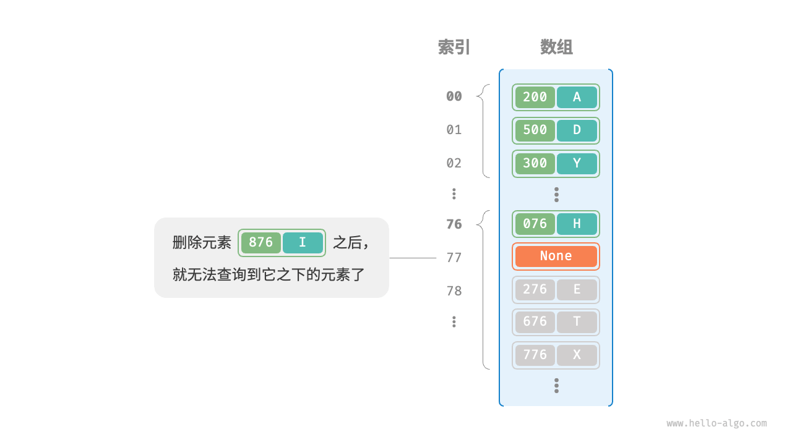

# 哈希冲突

## 两个号码掉进同一个槽，后来的会盖掉前一个吗？

把表里的每一格叫作**槽位**。假设查找时用号码除以 4 的余数 `key % 4` 选格子，2 和 6 都落在槽 2。可以把两条记录都串在这一格上，再比对完整的号码，这叫**链式地址**。也可以让后来的记录按固定顺序试其他格子，这叫**开放寻址**，逐格尝试的过程就叫**探测**。查询也要按同样的顺序试。

??? question "只比较槽号，会把哪两件事混在一起？"

    槽号只说明候选位置。还要比较完整的键才能判断相等，否则冲突会变成返回错误记录。

在上面的规则里，任意整数都可以作为键，但只会得到 0 到 3 四个下标。许多可能的键必须共用同一个下标。不同键算到同一个候选位置，就叫**哈希冲突**。

如果每个槽都只放一项、写入新键时直接覆盖，查 2 就可能拿到 6 的记录。增大表的容量有时可以把这两项分开，同时要重新计算位置、搬运已有记录，而且有些键换多大的表也会相撞。因此可以分两步解决问题。

1. 改良哈希表数据结构，**使得哈希表可以在出现哈希冲突时正常工作**。
2. 仅在必要时，例如记录数除以槽数（[负载因子](hash_map.md)）超过设定的上限时，才执行扩容。

哈希表的结构改良方法主要包括“链式地址”和“开放寻址”。

## 链式地址

在原始哈希表中，每个桶仅能存储一个键值对。<u>链式地址（separate chaining）</u>将单个元素转换为链表，将键值对作为链表节点，将所有发生冲突的键值对都存储在同一链表中。下图展示了一个链式地址哈希表的例子。



基于链式地址实现的哈希表的操作方法发生了以下变化。

- **查询元素**：输入 `key` ，经过哈希函数得到桶索引，即可访问链表头节点，然后遍历链表并对比 `key` 以查找目标键值对。
- **添加元素**：首先通过哈希函数访问链表头节点，然后将节点（键值对）添加到链表中。
- **删除元素**：根据哈希函数的结果访问链表头部，接着遍历链表以查找目标节点并将其删除。

链式地址存在以下局限性。

- **占用空间增大**：链表包含节点指针，它相比数组更加耗费内存空间。
- **查询效率降低**：因为需要线性遍历链表来查找对应元素。

以下代码给出了链式地址哈希表的简单实现，需要注意两点。

- 使用列表（动态数组）代替链表，从而简化代码。在这种设定下，哈希表（数组）包含多个桶，每个桶都是一个列表。
- 以下实现包含哈希表扩容方法。当负载因子超过 $\frac{2}{3}$ 时，我们将哈希表扩容至原先的 $2$ 倍。

=== "Python"

    ```python title="hash_map_chaining.py"
    class HashMapChaining:
        """链式地址哈希表"""

        def __init__(self):
            """构造方法"""
            self.size = 0  # 键值对数量
            self.capacity = 4  # 哈希表容量
            self.load_thres = 2.0 / 3.0  # 触发扩容的负载因子阈值
            self.extend_ratio = 2  # 扩容倍数
            self.buckets = [[] for _ in range(self.capacity)]  # 桶数组

        def hash_func(self, key: int) -> int:
            """哈希函数"""
            return key % self.capacity

        def load_factor(self) -> float:
            """负载因子"""
            return self.size / self.capacity

        def get(self, key: int) -> str | None:
            """查询操作"""
            index = self.hash_func(key)
            bucket = self.buckets[index]
            # 遍历桶，若找到 key ，则返回对应 val
            for pair in bucket:
                if pair.key == key:
                    return pair.val
            # 若未找到 key ，则返回 None
            return None

        def put(self, key: int, val: str):
            """添加操作"""
            # 当负载因子超过阈值时，执行扩容
            if self.load_factor() > self.load_thres:
                self.extend()
            index = self.hash_func(key)
            bucket = self.buckets[index]
            # 遍历桶，若遇到指定 key ，则更新对应 val 并返回
            for pair in bucket:
                if pair.key == key:
                    pair.val = val
                    return
            # 若无该 key ，则将键值对添加至尾部
            pair = Pair(key, val)
            bucket.append(pair)
            self.size += 1

        def remove(self, key: int):
            """删除操作"""
            index = self.hash_func(key)
            bucket = self.buckets[index]
            # 遍历桶，从中删除键值对
            for pair in bucket:
                if pair.key == key:
                    bucket.remove(pair)
                    self.size -= 1
                    break

        def extend(self):
            """扩容哈希表"""
            # 暂存原哈希表
            buckets = self.buckets
            # 初始化扩容后的新哈希表
            self.capacity *= self.extend_ratio
            self.buckets = [[] for _ in range(self.capacity)]
            self.size = 0
            # 将键值对从原哈希表搬运至新哈希表
            for bucket in buckets:
                for pair in bucket:
                    self.put(pair.key, pair.val)

        def print(self):
            """打印哈希表"""
            for bucket in self.buckets:
                res = []
                for pair in bucket:
                    res.append(str(pair.key) + " -> " + pair.val)
                print(res)
    ```

值得注意的是，当链表很长时，查询效率 $O(n)$ 很差。如果这些键之间有一致的比较次序，可以把链表改成会控制自身高度的平衡搜索树，例如 [AVL 树](../chapter_tree/avl_tree.md)或红黑树。当桶里有 $m$ 条记录时，这样查找最多比较 $O(\log m)$ 次，代价是增删后还要照看树的形状。

## 开放寻址

<u>开放寻址（open addressing）</u>不引入额外的数据结构，而是通过“多次探测”来处理哈希冲突，探测方式主要包括线性探测、平方探测和多次哈希等。

下面以线性探测为例，介绍开放寻址哈希表的工作机制。

### 线性探测

例如在同一个四格表中，键 2 已占槽 2，键 6 就试下一个槽 3。以后查 6 时也从槽 2 开始，先发现键不等，再去槽 3。每次固定前进一步的办法叫**线性探测**，到达表尾就绕回开头。

- **插入元素**：通过哈希函数计算桶索引，若发现桶内已有元素，则从冲突位置向后线性遍历（步长通常为 $1$ ），直至找到空桶，将元素插入其中。
- **查找元素**：若发现哈希冲突，则使用相同步长向后进行线性遍历，直到找到对应元素，返回 `value` 即可；如果遇到空桶，说明目标元素不在哈希表中，返回 `None` 。

下图展示了开放寻址（线性探测）哈希表的键值对分布。根据此哈希函数，最后两位相同的 `key` 都会被映射到相同的桶。而通过线性探测，它们被依次存储在该桶以及之下的桶中。



然而，**线性探测容易产生“聚集现象”**。具体来说，数组中连续被占用的位置越长，这些连续位置发生哈希冲突的可能性越大，从而进一步促使该位置的聚堆生长，形成恶性循环，最终导致增删查改操作效率劣化。

值得注意的是，**我们不能在开放寻址哈希表中直接删除元素**。这是因为删除元素会在数组内产生一个空桶 `None` ，而当查询元素时，线性探测到该空桶就会返回，因此在该空桶之下的元素都无法再被访问到，程序可能误判这些元素不存在，如下图所示。



删除键 2 后，可以在槽 2 放一块「这里原先有记录，查找请继续」的标记（`TOMBSTONE`，又称**墓碑**）。这样查 6 时还能走到槽 3。只留下标记、把格子的完整清理留到稍后，这里叫**懒删除**。插入可以重复利用墓碑的位置，但应先确定沿途没有相同的键。

然而，**懒删除可能会加速哈希表的性能退化**。这是因为每次删除操作都会产生一个删除标记，随着 `TOMBSTONE` 的增加，搜索时间也会增加，因为线性探测可能需要跳过多个 `TOMBSTONE` 才能找到目标元素。

为此，考虑在线性探测中记录遇到的首个 `TOMBSTONE` 的索引，并将搜索到的目标元素与该 `TOMBSTONE` 交换位置。这样做的好处是当每次查询或添加元素时，元素会被移动至距离理想位置（探测起始点）更近的桶，从而优化查询效率。

以下代码实现了一个包含懒删除的开放寻址（线性探测）哈希表。为了更加充分地使用哈希表的空间，我们将哈希表看作一个“环形数组”，当越过数组尾部时，回到头部继续遍历。

=== "Python"

    ```python title="hash_map_open_addressing.py"
    class HashMapOpenAddressing:
        """开放寻址哈希表"""

        def __init__(self):
            """构造方法"""
            self.size = 0  # 键值对数量
            self.capacity = 4  # 哈希表容量
            self.load_thres = 2.0 / 3.0  # 触发扩容的负载因子阈值
            self.extend_ratio = 2  # 扩容倍数
            self.buckets: list[Pair | None] = [None] * self.capacity  # 桶数组
            self.TOMBSTONE = Pair(-1, "-1")  # 删除标记

        def hash_func(self, key: int) -> int:
            """哈希函数"""
            return key % self.capacity

        def load_factor(self) -> float:
            """负载因子"""
            return self.size / self.capacity

        def find_bucket(self, key: int) -> int:
            """搜索 key 对应的桶索引"""
            index = self.hash_func(key)
            first_tombstone = -1
            # 线性探测，当遇到空桶时跳出
            while self.buckets[index] is not None:
                # 若遇到 key ，返回对应的桶索引
                if self.buckets[index].key == key:
                    # 若之前遇到了删除标记，则将键值对移动至该索引处
                    if first_tombstone != -1:
                        self.buckets[first_tombstone] = self.buckets[index]
                        self.buckets[index] = self.TOMBSTONE
                        return first_tombstone  # 返回移动后的桶索引
                    return index  # 返回桶索引
                # 记录遇到的首个删除标记
                if first_tombstone == -1 and self.buckets[index] is self.TOMBSTONE:
                    first_tombstone = index
                # 计算桶索引，越过尾部则返回头部
                index = (index + 1) % self.capacity
            # 若 key 不存在，则返回添加点的索引
            return index if first_tombstone == -1 else first_tombstone

        def get(self, key: int) -> str:
            """查询操作"""
            # 搜索 key 对应的桶索引
            index = self.find_bucket(key)
            # 若找到键值对，则返回对应 val
            if self.buckets[index] not in [None, self.TOMBSTONE]:
                return self.buckets[index].val
            # 若键值对不存在，则返回 None
            return None

        def put(self, key: int, val: str):
            """添加操作"""
            # 当负载因子超过阈值时，执行扩容
            if self.load_factor() > self.load_thres:
                self.extend()
            # 搜索 key 对应的桶索引
            index = self.find_bucket(key)
            # 若找到键值对，则覆盖 val 并返回
            if self.buckets[index] not in [None, self.TOMBSTONE]:
                self.buckets[index].val = val
                return
            # 若键值对不存在，则添加该键值对
            self.buckets[index] = Pair(key, val)
            self.size += 1

        def remove(self, key: int):
            """删除操作"""
            # 搜索 key 对应的桶索引
            index = self.find_bucket(key)
            # 若找到键值对，则用删除标记覆盖它
            if self.buckets[index] not in [None, self.TOMBSTONE]:
                self.buckets[index] = self.TOMBSTONE
                self.size -= 1

        def extend(self):
            """扩容哈希表"""
            # 暂存原哈希表
            buckets_tmp = self.buckets
            # 初始化扩容后的新哈希表
            self.capacity *= self.extend_ratio
            self.buckets = [None] * self.capacity
            self.size = 0
            # 将键值对从原哈希表搬运至新哈希表
            for pair in buckets_tmp:
                if pair not in [None, self.TOMBSTONE]:
                    self.put(pair.key, pair.val)

        def print(self):
            """打印哈希表"""
            for pair in self.buckets:
                if pair is None:
                    print("None")
                elif pair is self.TOMBSTONE:
                    print("TOMBSTONE")
                else:
                    print(pair.key, "->", pair.val)
    ```

### 平方探测

平方探测与线性探测类似，都是开放寻址的常见策略之一。当发生冲突时，平方探测不是简单地跳过一个固定的步数，而是第 $i$ 次从初始位置向后偏移 $i^2$ 格，对应 $1,4,9,\dots$，超过表长再绕回表头。

平方探测主要具有以下优势。

- 平方探测通过跳过探测次数平方的距离，试图缓解线性探测的聚集效应。
- 平方探测会跳过更大的距离来寻找空位置，有助于数据分布得更加均匀。

然而，平方探测并不是完美的。

- 仍然存在聚集现象，即某些位置比其他位置更容易被占用。
- 由于平方的增长，平方探测可能不会探测整个哈希表，这意味着即使哈希表中有空桶，平方探测也可能无法访问到它。

### 多次哈希

顾名思义，多次哈希方法使用多个哈希函数 $f_1(x)$、$f_2(x)$、$f_3(x)$、$\dots$ 进行探测。

- **插入元素**：若哈希函数 $f_1(x)$ 出现冲突，则尝试 $f_2(x)$ ，以此类推，直到找到空位后插入元素。
- **查找元素**：在相同的哈希函数顺序下进行查找，直到找到目标元素时返回；若遇到空位或已尝试所有哈希函数，说明哈希表中不存在该元素，则返回 `None` 。

与线性探测相比，多次哈希方法不易产生聚集，但多个哈希函数会带来额外的计算量。

!!! tip

    请注意，开放寻址（线性探测、平方探测和多次哈希）哈希表都存在“不能直接删除元素”的问题。

## 编程语言的选择

不同语言和版本的实现会选择不同的冲突处理方式。下面两个例子用于比较「在数组里另找位置」与「在同一桶里收纳多条记录」。

- CPython 3.13 的 `dict` 用开放寻址，探测位置按与键的哈希值相关的规则计算，使不同哈希值不一定沿同一串位置查找。[CPython 3.13 实现](https://github.com/python/cpython/blob/v3.13.0/Objects/dictobject.c)
- Java 8 的 `HashMap` 可以把相撞的记录放在同一个桶里，条件满足时将很长的一串记录改成一棵平衡搜索树。[Java 8 的 HashMap 改动](https://openjdk.org/jeps/180)
