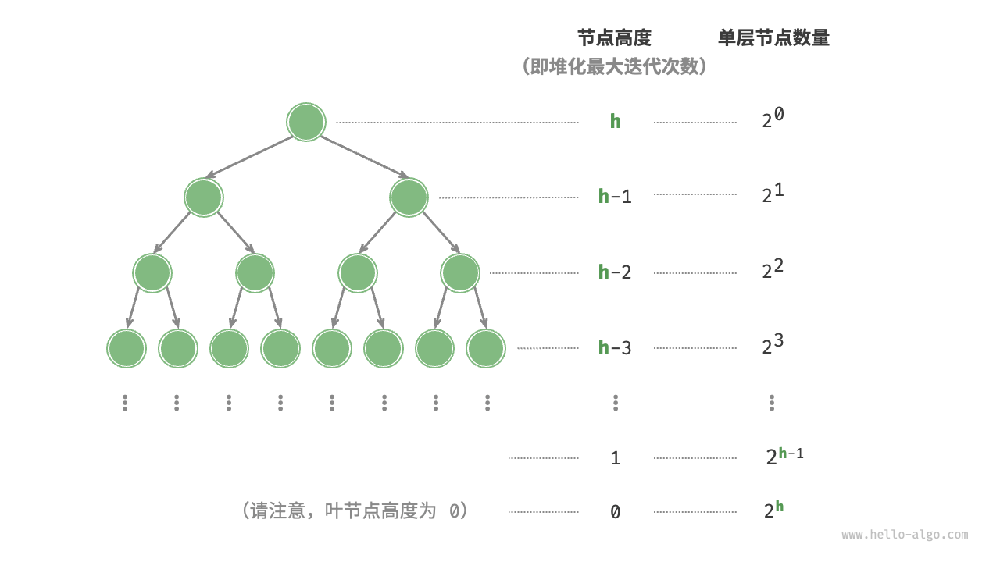

# 建堆操作

## 从空堆逐次插入，和从下面整理有什么不同？

若手里已有全部数据，可以从最后一个有孩子的节点向前整理。叶子天然满足堆条件；父节点向下调整时，它的两个子树已经满足条件。靠近底部的节点很多，但最多只需下移很少层，因此总开销可以是线性的。

??? question "为什么不能简单地用节点数乘树高估算紧上界？"

    那样相当于假设每个节点都从根走到底。真实建堆中大多数节点靠近叶子，能调整的距离更短。

在某些情况下，我们希望使用一个列表的所有元素来构建一个堆，这个过程被称为“建堆操作”。

## 借助入堆操作实现

我们首先创建一个空堆，然后遍历列表，依次对每个元素执行“入堆操作”，即先将元素添加至堆的尾部，再对该元素执行“从底至顶”堆化。

每当一个元素入堆，堆的长度就加一。由于节点是从顶到底依次被添加进二叉树的，因此堆是“自上而下”构建的。

设元素数量为 $n$ ，每个元素的入堆操作使用 $O(\log{n})$ 时间，因此该建堆方法的时间复杂度为 $O(n \log n)$ 。

## 通过遍历堆化实现

实际上，我们可以实现一种更为高效的建堆方法，共分为两步。

1. 将列表所有元素原封不动地添加到堆中，此时堆的性质尚未得到满足。
2. 倒序遍历堆（层序遍历的倒序），依次对每个非叶节点执行“从顶至底堆化”。

**每当堆化一个节点后，以该节点为根节点的子树就形成一个合法的子堆**。而由于是倒序遍历，因此堆是“自下而上”构建的。

之所以选择倒序遍历，是因为这样能够保证当前节点之下的子树已经是合法的子堆，这样堆化当前节点才是有效的。

值得说明的是，**由于叶节点没有子节点，因此它们天然就是合法的子堆，无须堆化**。如以下代码所示，最后一个非叶节点是最后一个节点的父节点，我们从它开始倒序遍历并执行堆化：

=== "Python"

    ```python title="my_heap.py"
        def __init__(self, nums: list[int]):
            """构造方法，根据输入列表建堆"""
            # 将列表元素原封不动添加进堆
            self.max_heap = nums
            # 堆化除叶节点以外的其他所有节点
            for i in range(self.parent(self.size() - 1), -1, -1):
                self.sift_down(i)
    ```

## 复杂度分析

下面，我们来尝试推算第二种建堆方法的时间复杂度。

- 假设完全二叉树的节点数量为 $n$ ，则叶节点数量为 $(n + 1) / 2$ ，其中 $/$ 为向下整除。因此需要堆化的节点数量为 $(n - 1) / 2$ 。
- 在从顶至底堆化的过程中，每个节点最多堆化到叶节点，因此最大迭代次数为二叉树高度 $\log n$ 。

将上述两者相乘，可得到建堆过程的时间复杂度为 $O(n \log n)$ 。**但这个估算结果并不准确，因为我们没有考虑到二叉树底层节点数量远多于顶层节点的性质**。

接下来我们来进行更为准确的计算。为了降低计算难度，假设给定一个节点数量为 $n$ 、高度为 $h$ 的“完美二叉树”，该假设不会影响计算结果的正确性。



如上图所示，节点“从顶至底堆化”的最大迭代次数等于该节点到叶节点的距离，而该距离正是“节点高度”。因此，我们可以对各层的“节点数量 $\times$ 节点高度”求和，**得到所有节点的堆化迭代次数的总和**。

$$
T(h) = 2^0h + 2^1(h-1) + 2^2(h-2) + \dots + 2^{(h-1)}\times1
$$

化简上式需要借助中学的数列知识，先将 $T(h)$ 乘以 $2$ ，得到：

$$
\begin{aligned}
T(h) & = 2^0h + 2^1(h-1) + 2^2(h-2) + \dots + 2^{h-1}\times1 \newline
2 T(h) & = 2^1h + 2^2(h-1) + 2^3(h-2) + \dots + 2^{h}\times1 \newline
\end{aligned}
$$

使用错位相减法，用下式 $2 T(h)$ 减去上式 $T(h)$ ，可得：

$$
2T(h) - T(h) = T(h) = -2^0h + 2^1 + 2^2 + \dots + 2^{h-1} + 2^h
$$

观察上式，发现 $T(h)$ 是一个等比数列，可直接使用求和公式，得到时间复杂度为：

$$
\begin{aligned}
T(h) & = 2 \frac{1 - 2^h}{1 - 2} - h \newline
& = 2^{h+1} - h - 2 \newline
& = O(2^h)
\end{aligned}
$$

进一步，高度为 $h$ 的完美二叉树的节点数量为 $n = 2^{h+1} - 1$ ，易得复杂度为 $O(2^h) = O(n)$ 。以上推算表明，**输入列表并建堆的时间复杂度为 $O(n)$ ，非常高效**。
