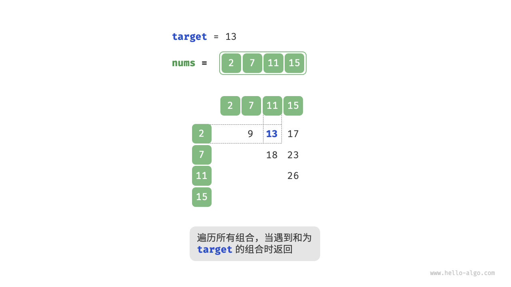
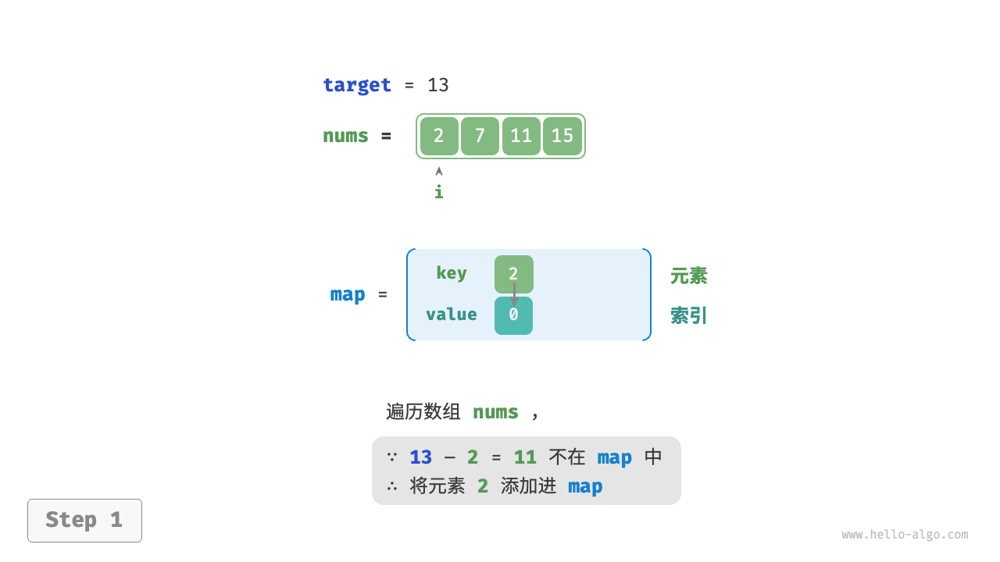
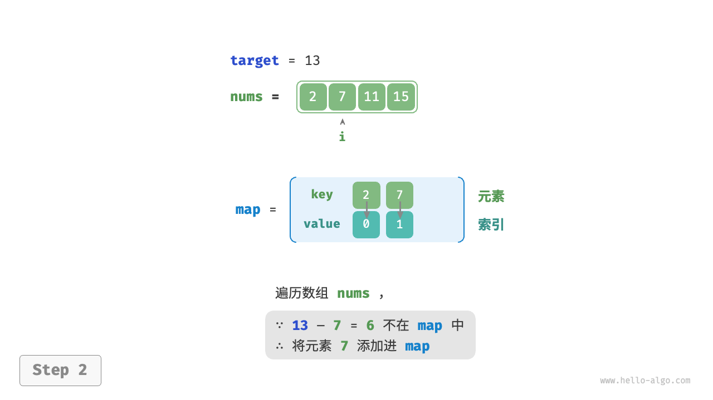
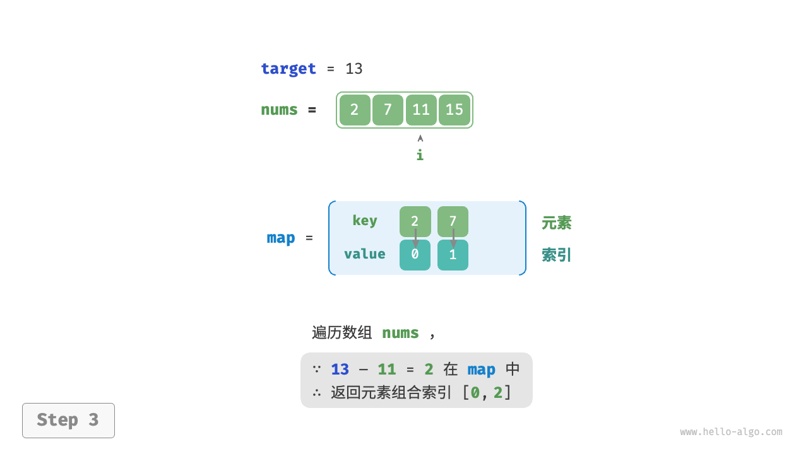

# 哈希优化策略

## 读到一个数，能不能马上知道它缺哪个搭档？

目标和是 9。读到 `2` 时，把它加入已见集合；读到 `7` 时，先查是否见过 `9 − 7 = 2`，就找到一对。每个新数只查询之前的数据，可以在读入时完成配对，也自然避免同一个位置被使用两次。

??? question "目标为 6，只读到了一个 `3`，应该返回一对吗？"

    如果题意要求两个不同位置，需要等第二个 `3`。先查询、再加入当前项可以保持这一顺序。

在算法题中，**我们常通过将线性查找替换为哈希查找来降低算法的时间复杂度**。我们借助一个算法题来加深理解。

!!! question

    给定一个整数数组 `nums` 和一个目标元素 `target` ，请在数组中搜索“和”为 `target` 的两个元素，并返回它们的数组索引。返回任意一个解即可。

## 线性查找：以时间换空间

考虑直接遍历所有可能的组合。如下图所示，我们开启一个两层循环，在每轮中判断两个整数的和是否为 `target` ，若是，则返回它们的索引。



代码如下所示：

=== "Python"

    ```python title="two_sum.py"
    def two_sum_brute_force(nums: list[int], target: int) -> list[int]:
        """方法一：暴力枚举"""
        # 两层循环，时间复杂度为 O(n^2)
        for i in range(len(nums) - 1):
            for j in range(i + 1, len(nums)):
                if nums[i] + nums[j] == target:
                    return [i, j]
        return []
    ```

此方法的时间复杂度为 $O(n^2)$ ，空间复杂度为 $O(1)$ ，在大数据量下非常耗时。

## 哈希查找：以空间换时间

考虑借助一个哈希表，键值对分别为数组元素和元素索引。循环遍历数组，每轮执行下图所示的步骤。

1. 判断数字 `target - nums[i]` 是否在哈希表中，若是，则直接返回这两个元素的索引。
2. 将键值对 `nums[i]` 和索引 `i` 添加进哈希表。

=== "<1>"
    

=== "<2>"
    

=== "<3>"
    

实现代码如下所示，仅需单层循环即可：

=== "Python"

    ```python title="two_sum.py"
    def two_sum_hash_table(nums: list[int], target: int) -> list[int]:
        """方法二：辅助哈希表"""
        # 辅助哈希表，空间复杂度为 O(n)
        dic = {}
        # 单层循环，时间复杂度为 O(n)
        for i in range(len(nums)):
            if target - nums[i] in dic:
                return [dic[target - nums[i]], i]
            dic[nums[i]] = i
        return []
    ```

此方法通过哈希查找将时间复杂度从 $O(n^2)$ 降至 $O(n)$ ，大幅提升运行效率。

由于需要维护一个额外的哈希表，因此空间复杂度为 $O(n)$ 。**尽管如此，该方法的整体时空效率更为均衡，因此它是本题的最优解法**。
