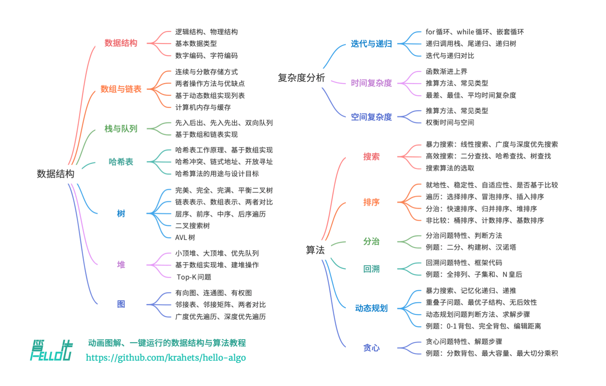

# 数据结构与算法

从一个可以手算的问题开始：四项任务到达时间不同，有的还要等其他任务完成，你会怎样决定谁先运行？课程先讲清数据怎么存、操作要付出多少成本，再用队列、堆和图一步步完成这个例子。

如果只会写循环，可以先读[数组的五格插入](chapter_array_and_linkedlist/array.md)：画出每次搬动后哪一格改变。然后用[链表的同一组号码](chapter_array_and_linkedlist/linked_list.md)做同样的插入，回头看[为什么有的操作是 $O(1)$，有的是 $O(n)$](chapter_computational_complexity/time_complexity.md)。首次阅读选自己会的一种语言即可，其他语言的代码留作对照。

## 怎么读

| 阶段 | 先掌握什么 | 可以动手做什么 |
| --- | --- | --- |
| 第 1–2 章 | [问题、约束与循环不变量](chapter_introduction/reason_about_algorithms.md)，以及[复杂度](chapter_computational_complexity/index.md) | 找出最早任务，手推循环并估算开销 |
| 第 3–8 章 | 数组、链表、[有界队列](chapter_stack_and_queue/bounded_queue.md)、哈希、树、[堆](chapter_heap/heap.md)、搜索和排序 | 改一个操作频率，比较数据结构是否还适合 |
| 第 9–10 章 | 遍历、[最短路径](chapter_graph/shortest_paths.md)与[拓扑排序](chapter_graph/topological_sort.md) | 在同一张图里分清找路径与满足依赖 |
| 第 11–13 章 | 分治、回溯、动态规划与贪心 | 用反例检验选择策略，再做[任务调度综合练习](chapter_task_scheduling/index.md) |

初次阅读，能把示例手推一遍，再跑熟悉语言里的实现。读到复杂度时同时写下条件，比如输入是否有序、边权能否为负、插入位置是否已经找到。实验偶尔会得到相反直觉，原因可能是数据规模、分布或内存访问方式。

## 原始资料与拓展

本笔记中的大部分内容修改自 [Hello 算法](https://www.hello-algo.com/) 项目，原项目由 [krahets](https://github.com/krahets/hello-algo) 创建，并遵循 [CC BY-NC-SA 4.0](https://creativecommons.org/licenses/by-nc-sa/4.0/) 许可证。这里的改写、删补和新增内容均为个人学习记录与扩展。

下图是原项目的学习地图，可用于对照知识点。

- [VisuAlgo 图遍历](https://visualgo.net/zh/dfsbfs)可逐帧观察 BFS 与 DFS。
- [MIT 6.006 讲义](https://ocw.mit.edu/courses/6-006-introduction-to-algorithms-spring-2020/resources/lecture-notes/)适合在做完小例子后核对条件和证明。
